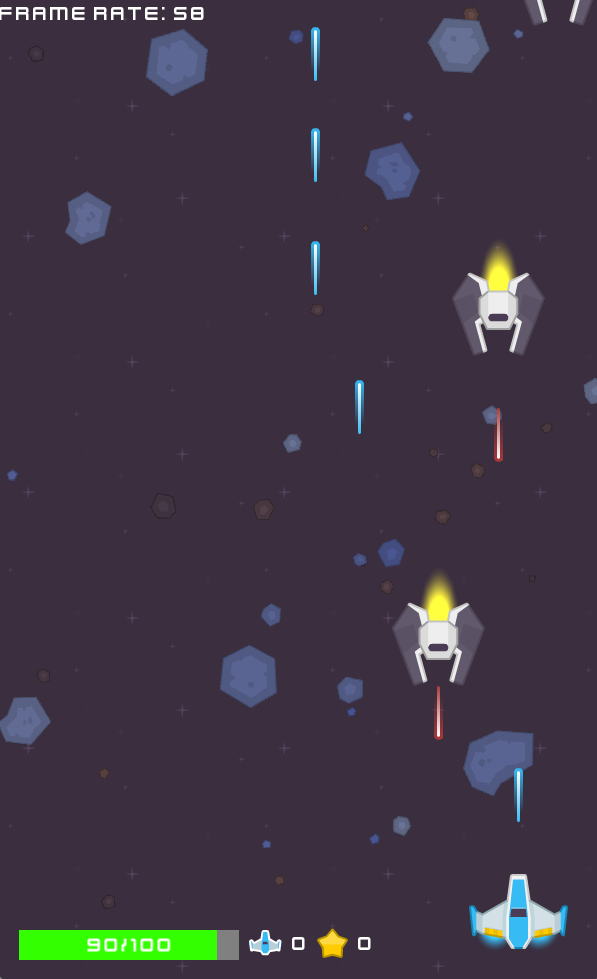
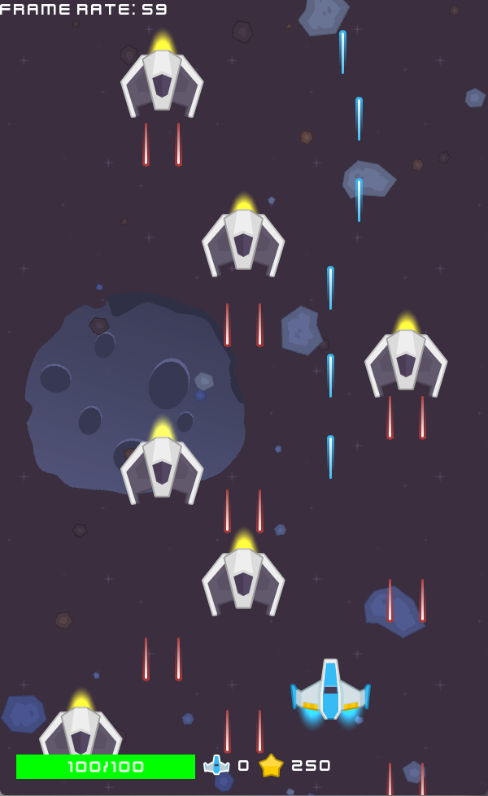

# Light Years


A high-performance 2D space shooter built from scratch with Vega Engine, featuring dynamic lighting, advanced physics, and procedurally managed enemy waves.

---

## Documentation

- [Console and Profiler](../Vega/docs/console-profiler.md) — panels, runtime capture and editor script commands.

- [Ability Scaling Catalog](docs/ABILITY_SCALING_CATALOG.md) — the single source of
  truth for every ability's values, formulas, per-level growth and behaviour.
- [System Reference](docs/PROJECT_DOCUMENTATION.md) — how the runtime systems work
  (engine, ability/effect pipeline, content loading).
- [Implementation Catalog](docs/CURRENT_IMPLEMENTATION_CATALOG.md) — where content
  lives in the source tree.
- [Identity & Contract Rules](docs/IDENTITY_AND_CONTRACT_RULES.md) — id and data
  contract rules.
- [Roguelite Design](docs/Designs.md) — long-term product direction.
- [Presentation Contract](docs/PROJECT_DOCUMENTATION.md#301-ability-presentation-profile-kontratı) — typed
  presentation and VFX integration rules.
- [Archive](docs/archive/2026-09/README.md) — dated work reports and old snapshots;
  historical only, not current truth.

---

## Introduction

**Light Years** is a modern C++17 space shooter game built from the ground up with Vega Engine. The player commands a hero spaceship against waves of enemy ships through procedurally managed stages, culminating in a boss battle and an infinite survival mode.

**Project Origin & Evolution:**
This project initially started as part of the **[Learn C++ and Make a Game from Scratch](https://www.udemy.com/course/complete-game-development-series-04-making-a-game-with-c/learn/lecture/40817092#overview)** course on Udemy. It has since been significantly expanded with custom systems including shaders, sound system, parallax scrolling, multi-phase boss AI, and more.

You can download the game from this repository (see `LightYears.7z`) or from [itch.io](https://parsik4.itch.io/light-years).

---

## Security & Antivirus Verification

**Important Notice:** This is an **unsigned executable** from an independent developer. Windows Defender may show a SmartScreen warning.

**VirusTotal Scan Results:**
- **Verified Clean** by 60+ antivirus engines
- [View Full VirusTotal Report](https://www.virustotal.com/gui/file/c860514a1a724c28256f4c11d9118023c3ee707371953c9baf50399e572bde64/detection)

*Note: Any generic "suspicious" flags are **false positives** common to unsigned C++ games.*

---

## Screenshots

<p align="center">
  
  
</p>

---

## Key Features

### Gameplay
- **5 Enemy Types** with unique AI behaviors:
  - **Vanguard** — Straight dive attack
  - **TwinBlade** — Dual-weapon dive attack
  - **Hexagon** — Multi-directional fire
  - **UFO** — Bouncing movement with screen-edge reflection
  - **Boss** — Multi-phase fight with escalating weapons
- **Elite Variants** — Stronger versions of standard enemies (higher HP, damage, score)
- **Ability-Based Combat** — Slot-based ability system (PrimaryWeapon + active skills through the SAS-backed ability runtime)
- **Shield System** — Activatable shield with HP absorption, cooldown, and HUD integration
- **Arena Combat Mode** — Free 2D thrust/drift movement with camera follow (ThrustDrift mode)
- **Infinite Survival Mode** — Endless waves with escalating difficulty and formation patterns
- **Power-up System** — Health (+25 HP), Shield, Extra Lives
- **Weighted Loot Drops** — Each enemy type has unique reward probabilities
- **Scoring System** — Points per enemy type (Vanguard: 10, TwinBlade: 20, Hexagon: 30, UFO: 40, Boss: 500)

### Technical
- **Dynamic Lighting** — GLSL point light shaders with radial falloff, engine glow, projectile trails
- **Parallax Scrolling** — Multi-layer backgrounds with planets and meteors at different depth speeds
- **Advanced Audio System** — Music cross-fading, intro+loop pattern (boss theme), sound pooling, time scaling
- **Performance-Aware VFX** — Explosion particles auto-throttle based on active actor count
- **Optimized Rendering** — Lazy sorting (97% fewer sort calls), depth-sorted actors
- **Box2D 3.x Physics** — Circle/polygon collision shapes with team-based filtering

---

## Project Structure

LightYearsGame/ owns runtime, content, tests and the LightYearsEditor host.
LightYearsVisual/ owns game visuals and authored catalogs; tools/ and docs/ are game-owned.
The sibling Vega checkout owns engine, scripting, GAS, Sky and editor core. See [engine dependency](docs/engine.md).

### Content data boundary

The shipped content model is hybrid. Runtime gameplay values for the current
weapons, player ship, abilities, and gameplay effects are loaded from
`LightYearsGame/assets/content/data/*.json`; C++ retains schemas, validation,
behavior/action definitions, registries, and typed presentation profiles.
Attachment runtime equip/resolve is present, but bootstrap and acquisition are
not complete yet.

JSON holds balance and value/reference content. C++ continues to own schemas,
validation, gameplay tags, behavior/weapon handlers, runtime state and typed
presentation profiles. CSV is reserved for balance import/export and analysis,
not as the runtime source.

---

## Build Instructions

Use a Visual Studio 2022 developer shell, CMake 3.31.6+ and Ninja. Place Vega
alongside this checkout (`../Vega`), or select it explicitly:

```bat
cmake -S . -B build -G Ninja -DCMAKE_BUILD_TYPE=Debug -DVEGA_ENGINE_DIR=D:/Vega-engine-next -DFETCHCONTENT_FULLY_DISCONNECTED=ON
cmake --build build
ctest --test-dir build --output-on-failure
build\LightYearsGame\LightYearsGame.exe
build\VegaEditor\LightYearsEditor.exe
```

For offline configuration, seed `build/_deps` with the dependency `*-src` trees
from an existing Vega build. `tools/vega-build.cmd` does this using
`VEGA_DEPS_SEED` (defaults to `%VEGA_ENGINE_DIR%\build\_deps`) and forwards
`VEGA_ENGINE_DIR` and `VEGA_CMAKE_ARGS` to CMake. Its arguments go to the build.
Engine binaries live under this game's `build/engine` directory.

GAS and Sky are required and enabled explicitly. `VEGA_BUILD_EDITOR` and
`LIGHTYEARS_BUILD_VISUAL_GALLERY` default ON; `VEGA_BUILD_TEMPLATES` defaults OFF.
Engine tests keep their embedded default OFF. `BUILD_TESTING` controls game tests.
The [engine contract](../Vega/docs/new-game.md) documents public targets/helpers.

## Controls

| Key | Action |
|-----|--------|
| **W / ↑** | Move Up |
| **A / ←** | Move Left |
| **S / ↓** | Move Down |
| **D / →** | Move Right |
| **Space** | Shoot |
| **Q** | FrostMaelstrom |
| **E** | NanoPlague |
| **F** | SeismicCharge |
| **R** | Cryostasis |
| **ESC** | Pause Menu |

---

## Current Features

- ✅ Custom game engine with actor lifecycle management
- ✅ 5 enemy types + elite variants with unique AI behaviors
- ✅ Multi-phase boss fight with health-based stage transitions
- ✅ SAS-backed, runtime-rebindable ability loadout and shipped behavior catalog
- ✅ Projectile transformation (Relay Prism), charge burst (Hull Shock), temporary overshield, orbital drones, and kill-stack combat drive
- ✅ Arena combat mode with free 2D thrust/drift movement
- ✅ Shield ability with HP absorption, cooldown, and HUD integration
- ✅ Infinite survival mode with escalating difficulty
- ✅ Dynamic GLSL lighting (engine glow, projectile trails, flicker)
- ✅ Multi-layer parallax scrolling with planets and meteors
- ✅ Advanced audio (cross-fading, intro+loop, sound pooling, time scaling)
- ✅ Hybrid content model: JSON data files with C++ schemas, validators, behaviors, and presentation registries
- ✅ Box2D 3.x physics with team-based collision filtering
- ✅ Performance-aware particle throttling
- ✅ Full UI system (main menu, pause, game over, in-game HUD)
- ✅ MVC HUD architecture (HUDController → SkillUIController / GameplayWarningHUDController)
- ✅ Power-up system with weighted loot tables
- ✅ Asteroid obstacles with recursive splitting

## Planned Features

<!-- Add your planned features here -->

---

## System Requirements

| Component | Requirement |
|-----------|------------|
| **OS** | Windows 10/11 (64-bit) |
| **CPU** | Dual-core 2.0 GHz+ |
| **RAM** | 2 GB |
| **GPU** | OpenGL 3.3+ support |
| **Storage** | 500 MB |

Users may need: [Visual C++ Redistributable 2022](https://aka.ms/vs/17/release/vc_redist.x64.exe)

---

## Known Issues

- 🐛 **Console Window** appears in Debug mode (intentional for logging)
- 🐛 **No gamepad support** — keyboard only

---

## Contributing

This is a **portfolio project** not accepting external contributions. However, feel free to:
- Fork for learning purposes
- Report bugs via [GitHub Issues](https://github.com/MuhammetKarakass/LightYears/issues)

---

## License

**Educational & Portfolio Use Only**

This project is for demonstration purposes. Game assets (SpaceShooterRedux pack) are from [Kenney.nl](https://kenney.nl) under CC0 license.

---

## Developer

**Muhammet Ali Karakaş**
- 📧 Email: m.karakas.buisness@gmail.com
- 💼 LinkedIn: [Muhammet Ali Karakaş](https://www.linkedin.com/in/muhammet-ali-karakas/)

---

## Acknowledgments

- **SFML Team** — Multimedia library foundation
- **Box2D** (Erin Catto) — Physics engine
- **Kenney.nl** — Space shooter art pack (CC0)
