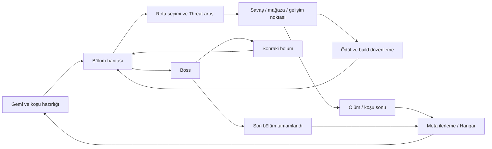

# Light Years — Oyun Tasarım Dokümanı (GDD)

**Sürüm:** 1.0 · **Tarih:** 2 Ekim 2026 · **Dil:** Türkçe
**Amaç:** Projeyi ilk kez gören birinin oyunun ne sunduğunu, sistemlerin neden böyle tasarlandığını, dengelemenin nasıl çalıştığını ve hangi işlerin sırada olduğunu anlayabilmesi.

> Light Years, farklı gemiler ve sabit ana silahlar etrafında kurulan, açık arenada hareket ve nişan alma becerisini modül yerleşimi ve yetenek kombinasyonlarıyla birleştiren bir uzay aksiyon roguelite projesidir. Savaş ve gemi geliştirme prototipi mevcuttur; dallanan bölüm haritası, biyomlar ve kalıcı ilerleme hedef tasarımdır.

## Okuma rehberi

| Aradığın bilgi | Bölüm |
|---|---|
| Oyun nedir; oyuncu ne yapar? | [1. Kimlik ve deneyim](#1-kimlik-ve-deneyim), [2. Oyun döngüsü](#2-oyun-döngüsü) |
| Şu anda ne çalışıyor? | [3. Mevcut durum](#3-mevcut-durum) |
| Gemiler neden farklı? | [4. Gemi kadrosu](#4-gemi-kadrosu) |
| Silah gücü nasıl karşılaştırılır? | [5. Ana silahlar](#5-ana-silahlar) |
| Hasar, zırh ve status ne yapıyor? | [6. Savaş ve denge matematiği](#6-savaş-ve-denge-matematiği) |
| Build nasıl kurulur? | [7. Yetenekler](#7-yetenekler), [8. Modüller](#8-modüller) |
| Seviye ve ekonomi nasıl ilerler? | [9. İlerleme ve ekonomi](#9-ilerleme-ve-ekonomi) |
| Bölüm, rota ve düşman planları | [10. Koşu dünyası](#10-koşu-dünyası) |
| Denge için neye bakılacak? | [12. Dengeleme yöntemi](#12-dengeleme-yöntemi) |
| Sıradaki işler ve açık kararlar | [13. Yol haritası](#13-yol-haritası), [14. Açık kararlar](#14-açık-kararlar) |
| Bir değerin ayrıntılı kaynağı | [15. Kaynak ve bakım rehberi](#15-kaynak-ve-bakım-rehberi) |

**Durum etiketleri:** **Mevcut** = kaynakta uygulama/veri var; oyun içi kalite veya denge kabulü anlamına gelmez. **Geçici test** = prototipi incelemek için açık davranış. **Plan** = tasarım yönü, tamamlanmış özellik değildir. **Açık** = karar veya doğrulama bekliyor. **Öneri** = bu GDD'nin çalışma önerisi, onaylanmış proje kararı değildir.

Bu doküman açıklayıcı üst bakıştır. Yeteneklerin tam sayısal sözleşmesi [Ability Scaling Catalog](ABILITY_SCALING_CATALOG.md), yüklenen gemi/silah/modül sayıları ilgili JSON dosyaları tarafından yönetilir. Buradaki referans tabloları 2 Ekim 2026 anlık görüntüsüdür; değer değiştirmek için önce [kaynak rehberindeki](#15-kaynak-ve-bakım-rehberi) sahibine gidilir.

## 1. Kimlik ve deneyim

### 1.1 Oyun özeti

Oyuncu bir uzay gemisini serbest iki boyutlu arenada yönetir. Geminin hızı, ivmesi, dönüşü, savunması ve kendine özgü ana silahı başlangıç oyun tarzını belirler. Aktif yetenekler ve gemi şemasına yerleştirilen modüller bu kimliği koşu boyunca değiştirir.

Hedef koşuda oyuncu bir bölümün dallanan haritasından rota seçer; savaş, ödül ve mağaza noktalarından geçerek boss'a ulaşır. Daha fazla ödül için uzayan rota, daha yüksek Threat ve daha zor karşılaşmalar getirir. Koşu sonrasında kalıcı ilerleme yeni seçenekler açar.

| Başlık | Tanım |
|---|---|
| Tür | Uzay temalı aksiyon roguelite; açık arena / twin-stick yönü |
| Bakış | Üstten görünüm; gemiyi izleyen kamera |
| Temel beceri | Momentum yönetimi, nişan, konumlanma, yetenek zamanlaması |
| Build kararı | Sabit ana silahın çevresine yetenek ve modül kombinasyonu kurma |
| Mevcut teknoloji | Özel C++17 / SFML motoru ve oyun katmanı |
| Mevcut giriş | Arena prototipi; klavye hareketi ve fareyle nişan |
| Açık ürün kararları | Hedef platform kapsamı, gamepad desteği, koşu süresi, yayın kapsamı, fiyatlandırma |

### 1.2 Tasarım sütunları

1. **Gemi seçimi anlamlıdır.** Her geminin güvenli ve zorlandığı durumlar farklı olmalı; tek bir gemi her görevi en iyi yapmamalı.
2. **Hareket savaşın parçasıdır.** Kaçış, açı tutma ve alan hizalama, hasar sayısı kadar önemlidir.
3. **Build güç kadar davranışı da değiştirir.** Kalkanı sökmek, daha büyük modül taşımak veya kontrol yeteneği seçmek görünür bir bedel yaratır.
4. **Rota ödül ve risk arasında seçimdir.** Daha uzun keşif daha güçlü build ve daha tehlikeli bölüm getirir.
5. **Yoğun savaş okunabilir kalır.** Düşman silueti, tehlike işareti, status ve kaynak göstergeleri oyuncunun karar vermesine yardım eder.

Tam hikâye, evren anlatısı ve gemi pasiflerinin son listesi henüz bu kaynaklarda kesinleşmiş değildir.

## 2. Oyun döngüsü

### 2.1 Saniyeler ölçeğinde — mevcut savaş

**Konum al → hedefe açı tut → ana silahla baskı kur → yeteneği uygun anda kullan → hasardan kaçın → kalkan/afterburner/şarjör/ısı durumuna göre yeniden konumlan.**

Ana silah geminin sürekli erişilebilir saldırısıdır. Aktif yetenekler alan kontrolü, burst, savunma veya kaçış penceresi yaratır. Afterburner hız kaynağıdır; Dash gibi bir aktif hareket yeteneğiyle aynı sistem değildir.

### 2.2 Dakikalar ölçeğinde — hedef koşu



**Plan:** Harita ve meta akış henüz arena prototipinin tamamlanmış parçası değildir. İlk hedef, tek bölümde rota seçimi → birkaç karşılaşma → boss → bölüm kapanışı zinciridir.

## 3. Mevcut durum

| Sistem | Durum | Okuyucunun bilmesi gereken sınır |
|---|---|---|
| Açık arena, momentumlu hareket, takip kamerası | Mevcut | Aktif test arena alanı 6000 × 3000; ekranın tamamından büyük |
| Altı oyuncu gemisi ve kendine özgü silahları | Mevcut | F1–F6 seçimi koşuyu yeniden başlatır; ürün gemi seçme ekranı yok |
| Hasar, kalkan, armor, kritik ve status | Mevcut | Son silah/status düzeltmelerinin oyun içi denge kabulü açık |
| Aktif yetenek runtime'ı ve 55 tasarım kaydı | Mevcut | Kayıt sayısı bütün içerik için eşit kalite/E2E kanıtı değildir |
| Modül yerleşimi, bonuslar, sistem aç/kapa ve Tab ekranı | Mevcut | Görsel kabul, gerçek düşme/edinim ve ekonomi açık |
| HUD, pause, game over, restart | Mevcut | Son görsel kontroller açık; bazı göstergeler test amaçlı |
| Üç düşman davranışı ve dalga runtime'ı | Mevcut | Dalga sistemi aktif arena ayarıyla kapalı |
| Eğitim hedefleri | Geçici test | Dört sabit hedef, her biri 9000 HP; yerel kaynakta Armor 20 eklenmiş |
| Seviye başına otomatik yetenek/primary artışı | Geçici test | Ücretsiz artış, nihai Scrap ekonomisi kararı değildir |
| Başlangıçta modül varyantlarının verilmesi | Geçici test | Gerçek loot ve nadirlik dağılımı yerine geçmez |
| Bölüm haritası, rota, Threat, biyomlar | Plan | Tasarım yönü mevcut; tamamlanmış koşu akışı yok |
| Gold/Stardust ekonomisi, kalıcı profil, Hangar | Plan | Bellekteki progression/Scrap, disk kaydı ve tam ekonomi değildir |
| Yetenek edinme/değiştirme ve evolve seçimi | Plan | Runtime altyapısı ile oyuncuya sunulan seçim akışı ayrı işler |

**Kaynak sınırı:** Arena tablosu çalışma ağacını esas alır. `ArenaTestLevel.cpp` oturum başında zaten değiştirilmişti; GDD bu dosyayı düzenlemedi. Hedeflerin mevcut silahı Rapid Laser'dır; hareket etmemeleri saldırmadıkları anlamına gelmez. Bu arena tam bir koşunun zorluk veya loot dengesini temsil etmez.

## 4. Gemi kadrosu

### 4.1 Rol ve bedel

| Gemi | Ana silah | Güçlü olduğu durum | Tasarım bedeli |
|---|---|---|---|
| Fighter | Rapid Laser | Güvenilir uzun menzil; dengeli başlangıç | Uzman gemilerin ideal senaryodaki zirvesine ulaşmaz |
| Breacher | Rapid Shotgun | Yakın menzilde koniyle birden çok hedef | Yaklaşma riski; kısa menzil; daha düşük seyir hızı |
| Interceptor | Dual Kinetic Blaster | Hızlı giriş-çıkış, iki mermi, armor kırma | Düşük HP/kalkan; kısa baskı penceresi ve reload |
| Conductor | Electric Launcher | Yetenek kullanımıyla empowered zincir ve hasar açıklığı | Normal tek hedef baskısı sınırlı; yetenek zamanlamasına bağımlı |
| Aegis | Continuous Heat Laser | Büyük kalkan, armor büyümesi, sıcak ışın baskısı | Hantal hareket; düşük afterburner kapasitesi; overheat |
| Cryo Controller | Cryo Projector | Çoklu hedef hizalama, dalga ve yavaşlatma | Düşük tek hedef ham hasarı; Whiteout hazırlığı |

**Kaynak:** [Gemi/silah tasarımı](Light_Years_Ships_Primary_Weapons_Combined.md), güncel sayılar [ships.json](../LightYearsGame/assets/content/data/ships.json).

### 4.2 Başlangıç ve doğal büyüme

Hücrelerde **L1 / seviye başına artış** yazılır. `Değer(L) = L1 + artış × (L−1)`. HP gövde canıdır; kalkan ayrı havuzdur. AP saldırı gücü, EP enerji gücü, AS saldırı hızı rating'idir.

| Gemi | HP | AP | EP | Armor | Luck | AS | Seyir hız tavanı |
|---|---:|---:|---:|---:|---:|---:|---:|
| Fighter | 250 / +40 | 39 / +3 | 35 / +2 | 2 / +2 | 0 / +1 | 0 / +0 | 520 |
| Breacher | 290 / +60 | 45 / +2 | 34 / +0 | 3 / +2 | 0 / +1 | 0 / +0 | 490 |
| Interceptor | 200 / +30 | 41 / +3 | 28 / +1 | 1 / +1 | 1 / +1 | 1 / +1 | 590 |
| Conductor | 220 / +40 | 27 / +1 | 41 / +3 | 1 / +1 | 2 / +2 | 0 / +0 | 505 |
| Aegis | 270 / +50 | 25 / +1 | 43 / +3 | 4 / +3 | 0 / +1 | 0 / +0 | 480 |
| Cryo Controller | 250 / +40 | 27 / +1 | 40 / +2 | 2 / +2 | 1 / +1 | 0 / +0 | 520 |

Hızlar oyun dünyası birimidir. Aynı hız tavanına sahip gemiler ivme, yanal thrust ve dönüş yüzünden aynı hissi vermez: Breacher yakın açı düzeltmeye, Interceptor yüksek mobiliteye, Cryo yanal hizalamaya uygundur.

### 4.3 Gemi kalkanı ve afterburner

**Kesinleşmiş karar:** İkisi de EP'den bağımsızdır; gemi seviyesiyle büyür. EP artırmak geminin temel kalkanını doğrudan büyütmez; EP kullanan savunma yetenekleri ayrı katkı verir.

| Gemi | Kalkan L1 / artış | Tam şarj / hasar sonrası gecikme | AB kapasite L1 / artış | AB tüketim/sn | AB hız çarpanı |
|---|---:|---|---:|---:|---:|
| Fighter | 140 / +20 | 6 / 6 sn | 100 / +3 | 33 | ×1,55 |
| Breacher | 110 / +10 | 6 / 6 sn | 110 / +2 | 33 | ×1,65 |
| Interceptor | 110 / +15 | 6 / 6 sn | 120 / +4 | 30 | ×1,60 |
| Conductor | 130 / +20 | 5 / 5 sn | 95 / +3 | 33 | ×1,50 |
| Aegis | 160 / +30 | 7 / 4,5 sn | 75 / +2 | 36 | ×1,45 |
| Cryo Controller | 130 / +20 | 6 / 5,5 sn | 95 / +3 | 33 | ×1,50 |

`Kalkan regen/sn = maksimum kalkan / tam şarj süresi`. Aegis'in erken başlayan toparlanması ile Interceptor'ın yüksek AB süresi farklı savunma yollarıdır. HP + kalkan toplamı tek başına dayanıklılık kıyaslaması değildir; armor yalnız gövdeyi korur, kalkanın geri dolması da hasarsız pencere gerektirir.

## 5. Ana silahlar

### 5.1 L1 karşılaştırması

**Hesap koşulu:** Gemi ve silah L1, modülsüz temel değerler; her mermi isabet ediyor; hedefte armor/kalkan/status yok; kritik, empowered ve yeniden doldurma normal ham DPS sütununa dahil değil. Sayılar formülden hesaplanmıştır, oyun içi ölçüm değildir.

| Silah | Normal vuruş | Temel ritim | Normal ham DPS | Menzil | Özel güç penceresi |
|---|---:|---|---:|---:|---|
| Rapid Laser | 25,99 → normal final yuvarlama ile 26 | 4 atış/sn | 103,96; yuvarlamayla 104 | 1600 | 6 isabet sonrası empowered; şarjörün son 6 mermisi de empowered |
| Rapid Shotgun | 65 / hedef | 1,75 atış/sn | 113,75 / hedef | 650 | Her 3. atış ve şarjörün son 3 atışı (18'lik şarjör) 78,8 hasar ve Ignite |
| Dual Kinetic | 5,6 / mermi; 11,2 / çift | L1 AS=1 ile 6,06 çift/sn (taban 6) | 67,87; AS=0 referansı 67,2 | 900 | 8 isabetli atış sonrası her mermi 26,48; Kinetic stack |
| Electric Launcher | 39,1 / ilk hedef | 2 atış/sn | 78,2 / ilk hedef | 1200 | Yetenek kullanımıyla 2 şarj; 4 atış/sn; 45,38 / ilk hedef. İlk hedef imlece en yakın düşman |
| Heat Laser | 21,17 / tick | 0,25 sn tick | 84,68 düşük ısı | 1000 | Orta ısı ×1,15; yüksek ısı ×1,40 ve Energy |
| Cryo Projector | 28,1 / hedef | 2,5 dalga/sn | 70,25 / hedef | 1100 | Whiteout'ta dönüşümlü empowered; 35,9 veya önceden 4 stack varsa 41,285 |

İki mermili Dual'ı tek mermiyle, shotgun ve dalgayı yalnız tek hedefle veya Heat Laser'ı hep yüksek ısıda karşılaştırmak yanlış sonuç verir. Reload, ıskalama, hazırlanma ve hedef yoğunluğu gerçek gücü değiştirir.

**Reload etkisi örneği:** Empowered/crit olmadan uzun çevrim yaklaşımı `şarjör toplam hasarı / (ateş süresi + reload)` şeklindedir. Laser için `48×26 / (48/4+2) ≈ 89,14 DPS`; Dual için `64×5,6 / (32/6,06+1,5) ≈ 52,86 DPS`; Shotgun için (hedef başına) `18×65 / (18/1,75+2) ≈ 95,2 DPS`. Bunlar ilk atış/frame zamanlamasını idealize eden hesap örnekleridir; gerçek sustain için empowered sıklığı ve isabet oranı da ölçülür.

### 5.2 Silah davranışları ve oyuncu kararı

**Rapid Laser — referans silah.** Şarjör 48 mermi, reload 2 sn. İsabet sayacı boş atışları ödüllendirmez; empowered isabeti sonraki döngüye sayılır. Empowered bonusu L1'de `2 + EP×0,10 = 5,5`; kritik garantilidir. Başlangıç kritik çarpanı 1,5 ile `ceil((25,99+5,5)×1,5)=48`. Normal atışın 26 olması taban hasarın 26 olduğu anlamına gelmez: taban 10, AP katkısı 15,99'dur.

**Rapid Shotgun — koniyi hedefte tut.** Pellet atmaz; 45° toplam açılı anlık konide her geçerli hedef bir kez vurulur. Hedef sayısı arttığında hedef başına hasar azalmaz. Her üçüncü atışın ve 18'lik şarjörün son 3 atışının ek hasarı `EP×0,15 + MaxHP×0,03`; Breacher L1'de 13,8'dir. Şarjör 18 atıştır (reload 2 sn), dolu şarjörde 8 ayrı empowered atış çıkar. Ignite yalnız empowered atışta uygulanır. Çoklu hedef kazancı yakın mesafe riskiyle değerlendirilir.

**Dual Kinetic — baskı ve armor kırma.** İki namlu aynı anda ateş eder. Bir çift iki mermi harcar; 64 mermi = 32 çift, reload 1,5 sn. İsabet sayacına atış başına en fazla bir kayıt gider; iki merminin vurması sayacı iki artırmaz. Normal mermiler Photonic, empowered mermiler Kinetic'tir. Mermi sayısı, tetik sayısı ve isabetli atış sayısı farklı birimlerdir.

**Electric Launcher — yetenek ve silahı birlikte kullan.** Hasar yüksek AP/EP değerini %40, düşük olanı %10 kullanır. Ana silahın kendi aktivasyonu hariç yetenek kullanımı sonraki iki atışı empowered yapar; şarjlar üst üste birikmek yerine yenilenir. Zincir parametreleri 3, 250 mesafe ve bağlantı başına ×0,72'dir. Normal vuruş Photonic; empowered Electric hasar ve stack üretir. Gücünün bir bölümü sonraki saldırıları güçlendirmesinden gelir.

**Heat Laser — ısı bandını yönet.** Düşük ısıda Photonic ×1,00; %35–75 bandında ×1,15; %75 ve üzeri bölgede Energy ×1,40. Yüksek ısıdaki L1 tick yaklaşık 29,638, kalkan kapasitesi hasarı yaklaşık 44,457'dir. Isı kapasitesi 100, taban artış 38/sn, soğuma 25/sn, overheat beklemesi 2,5 sn. Artış eğrisi üst ısı bandında yavaşlar; yüksek çarpanı kalıcı DPS kabul etmek doğru değildir.

**Cryo Projector — hedefleri hizala.** Normal dalga, en az iki farklı hedefe vurunca +1 Frost Meter; önceden Cryo taşıyan hedefe vurunca ayrıca +1 verir. Her koşul dalga başına en fazla bir kez, toplam en fazla +2 verir. Sayaç 4'te Whiteout açar: 4 sn boyunca empowered → normal dönüşümü, sonra 3 sn sayaç kilidi. **Güncel Whiteout hız çarpanı ×1,00'dır; atış hızını ikiye katlamaz.** Empowered menzil +250, genişlik ×1,5, Cryo stack +1. Normal Photonic dalgalar Cryo süresini yenilemez. Önceden tam Cryo stack'i varsa empowered hasar ×1,15 alır; stack tüketilmez.

### 5.3 Seviye formülleri

`W` silah seviyesi, AP/EP/MaxHP sahibin o andaki değerleridir. Gemi seviyesi `S` ile silah seviyesi `W` kavramsal olarak ayrıdır; ücretsiz test artışı bunları birlikte yükseltebilir.

| Silah | Normal hasar formülü | Empowered ek hasar |
|---|---|---|
| Rapid Laser | `10 + 5(W−1) + 0,41×AP` | `2 + (W−1) + EP×[0,10+0,03(W−1)]`; ayrıca garantili kritik |
| Rapid Shotgun | `38 + 11(W−1) + AP×[0,60+0,04(W−1)]` | `0,15×EP + 0,03×MaxHP` |
| Dual Kinetic | `1,5 + 1(W−1) + AP×[0,10+0,01(W−1)]` / mermi | `5 + 2(W−1) + 0,08×AP + EP×[0,25+0,04(W−1)]` |
| Electric Launcher | `20 + 2(W−1) + max(AP,EP)×[0,40+0,02(W−1)] + min(AP,EP)×[0,10+0,01(W−1)]` | `3 + (W−1) + EP×[0,08+0,02(W−1)]` |
| Heat Laser | Tick: `13 + 2(W−1) + EP×[0,19+0,02(W−1)]` | Ayrı empowered yok; ısı bandı çarpanı |
| Cryo Projector | `20 + 2(W−1) + AP×[0,30+0,02(W−1)]` | `5 + 2(W−1) + EP×[0,07+0,01(W−1)]` |

Heat Laser JSON'u DPS saklar: L1 `52 + 0,76×EP`; tick karşılığı bunun dörtte biridir. AP katkısı yoktur. Tablolar güncel [weapons.json](../LightYearsGame/assets/content/data/weapons.json) ve [silah planı](WEAPON_PHASE2_PLAN.md) üzerinden okunmuştur; özel düzeltmeler için güncel runtime esastır.

## 6. Savaş ve denge matematiği

### 6.1 Temel statların anlamı

| Stat | Ne kazandırır? | Ne varsayılmamalı? |
|---|---|---|
| AP | AP katsayısı kullanan silah/yetenekleri güçlendirir | Her hasar kaynağı AP kullanmaz |
| EP | Enerji ölçekli hasar, empowered ve bazı savunma yetenekleri | Temel gemi kalkanı/AB doğrudan EP'den türemez |
| MaxHP | Gövde dayanıklılığı; HP ölçekli yetenekler | HP yatırımının yalnız savunma olduğu varsayılamaz |
| Armor | Kalkanı aşan gövde hasarını azaltır | Kalkanı korumaz; 20 armor, %20 azaltım değildir |
| AttackSpeed | Silah/yetenek kuralına göre ritim veya davranış | Her kaynaktaki katsayı aynı değildir |
| AbilityHaste | Ability cooldown: `bekleme / (1 + Haste/100)`; +100 Haste beklemeyi yarıya indirir (2026-10-26) | Global 0,25 sn combat tick'i hızlandırmaz |
| Luck | İlgili yetenekte zincir/hedef/üretim; combat/loot şansı | Her Luck puanı doğrudan aynı yüzdeye dönüşmez |
| CriticalChance / Damage | Kritik olasılığı ve kritik çarpanı | Empowered her silahta garantili kritik değildir |

### 6.2 Hasar sırası

**Ham hasar → kritik → incoming etkiler/status → savunma emilimi → kalan gövde hasarına armor → HP kaybı.** Barrier geçici bir savunma etkisidir; gemi kalkanından ayrı kapasite/süre kuralları vardır. Energy, kalkan kapasitesini ×1,5 tüketir; kalkan kırılınca gövdeye taşan kaynak hasarı ×1,5 ile şişirilmez.

```text
ArmorAzaltımı = max(0, Armor) / [max(0, Armor) + 100]
GövdeHasarı = GelenGövdeHasarı × 100 / [EtkinArmor + 100]
EtkinArmor = Armor × (1 − KineticArmorKırma)
```

Varsa saldırının ayrı armor penetration'ı bu hesabın üzerine uygulanır; Kinetic status ile aynı mekanik değildir.

| Armor | Hasar azaltımı | 100 gövde hasarından kalan |
|---:|---:|---:|
| 20 | %16,67 | 83,33 |
| 50 | %33,33 | 66,67 |
| 100 | %50 | 50 |
| 200 | %66,67 | 33,33 |
| 500 | %83,33 | 16,67 |

**Kinetic örneği:** 100 Armor taşıyan hedef dört stack ile 70 etkin Armor'a düşer. 100 ham gövde hasarı 50 yerine yaklaşık 58,82 verir. “%30 armor kırma”, doğrudan “%30 fazla hasar” anlamına gelmez. Photonic veya başka türde sonraki saldırı da azalan armor'dan yararlanır. Yeni stack aynı vuruşun eski-stack hesabına geriye dönük eklenmez.

### 6.3 Hasar türleri ve status

| Tür | Rol | 1 / 2 / 3 / 4 stack etkisi | Süre |
|---|---|---|---|
| Photonic | Nötr doğrudan hasar | Kendine ait stack etkisi yok | — |
| Energy | Kalkan karşıtı | Kalkan kapasitesine ×1,50 | Kaynak kuralına bağlı |
| Kinetic | Armor kırma | Armor −%6 / 12 / 18 / 30 | 6 sn |
| Electric | Hedefi hasara açma | Gelen hasar +%3 / 6 / 9 / 16 | 6 sn |
| Cryo | Hareket kontrolü | Slow %4 / 8 / 12 / 20 | 6 sn |
| Thermal | Ignite ile zamanla hasar | 1 / 2 / 3 / 5 DPS | 5 sn |

Electric, Cryo ve Kinetic için **aynı kaynağın aynı tür hasarı** süreyi yeniler. Altı saniye yenilenmezse tüm stack'ler birlikte kalkar; tek tek decay yoktur. Photonic normal atış ilgili elemental süreyi yenilemez. Bu üç oyuncu silahında normal/empowered tür ayrımı, yalnız empowered atışın stack eklemesini ve sürdürmesini sağlar; aynı türde başka yetenekler de ortak kurala tabidir.

Bütün periyodik/sürekli hasar **0,25 sn global tick** kullanır. “Tick başına 12” = kesintisiz dört tick'te 48/sn; “12 DPS” = tick başına 3. DOT, alan hasarı ve Heat Laser kıyaslamalarında bu ayrım zorunludur.

**Kaynaklar:** [damage_status_balance.json](../LightYearsGame/assets/content/data/damage_status_balance.json), [DamageTypeSystem.cpp](../LightYearsGame/src/gameplay/damage/DamageTypeSystem.cpp), [CombatRuntime.cpp](../LightYearsGame/src/gameplay/combat/CombatRuntime.cpp), [sistem referansı](PROJECT_DOCUMENTATION.md). Sistem referansının eski Kinetic/decay anlatımları güncel runtime'ı temsil etmez.

## 7. Yetenekler

### 7.1 Oyuncuya sunduğu karar

Ana silah gemiye bağlıdır. Hedef tasarımda oyuncu dört aktif yuvasını koşuda edinilen yeteneklerle kurar: daha fazla saldırı, savunma, hareket veya kontrol seçebilir. Şu anda test loadout'u vardır; edinme, değiştirme ve evolve seçim ekranı tamamlanmış değildir.

| Aile | Temel karar | Örnek |
|---|---|---|
| Offense | Hedef, alan, burst ve sürekli baskı | Rocket, SunBeam, NanoPlague, SeismicCharge |
| Defense | Hasarı emme, engelleme, geri kazanma veya karşı saldırı | Shield, Cryostasis, TemporalRecall, ReturnProtocol |
| Movement | Kaçış, mesafe, açı ve momentum | Dash, PhaseDrift, ZeroDrag, LanceDrive |
| Utility | Alan düzenleme, kontrol ve kombinasyon | GravityAnomaly, FrostMaelstrom, RelayPrism, EchoProtocol |

Primary ana silah ailesidir. **Control ayrı kategori değildir; Utility içindedir.** ScorchDrive ve LanceDrive Movement'tır. Eski katalog sınıf hücrelerinden farklı görünen satırlarda güncel ability ID ailesi esas alınır.

### 7.2 Örnek build mantığı

| Paket | Neden birlikte çalışır? | Ödenen bedel |
|---|---|---|
| Fighter + alan kontrolü + patlama | Hedefleri topla/tut; gecikmeli burst'ü yerleştir | Hazırlık süresi; hareketli tek hedefte daha az kazanç |
| Interceptor + LanceDrive / InertialWake | Momentum hem konum hem saldırı girdisi olur | Açı kontrolü ve giriş riskini yönetmek gerekir |
| Conductor + sık aktif kullanımı + Electric | Yetenek → iki empowered → vulnerability → takip hasarı | Cooldown'lar ve şarj ritmi birlikte yönetilir |
| Aegis + savunma/konum koruma | Işını hedefte tutarken savunma penceresi yaratır | Hareket kaybı ve overheat arası baskı düşüşü |
| Cryo + FrostMaelstrom / FrozenThrong | Cryo birikimi, alan kontrolü ve öldürme sonrası yayılma | Tek hedefte meter ve yayılma değeri düşer |

Bunlar kombinasyon açıklamalarıdır; dengelenmiş optimal build iddiası değildir. Tam mevcut tuş-yetenek tablosunun tek sahibi [DefaultAbilityLoadout.cpp](../LightYearsGame/src/gameplay/ability/loadout/DefaultAbilityLoadout.cpp)'dir.

### 7.3 Seviye ve cooldown örneği

SunBeam: `Hasar = 40 + 10(L−1) + EP×[0,70+0,10(L−1)]`. EP=35 sabit tutulursa L1 64,5; L5 118,5 ham hasardır. Gemi EP'si de büyüyorsa kazanç ayrıca artar. Bu yüzden yalnız taban hasar artışına bakılmaz.

Yetenek/primary seviyelerinin tasarım tavanı yoktur. Ortak cooldown progression'da `R0 = 0,175 + 0,025×temelCD`. L2–L5 aynı azaltım, sonraki her dört seviye yeni kademe: `R≥0,20` ise `R−0,10`, aksi halde `R×0,80`. Seviye başı azaltım en az 0,02 sn, cooldown tabanı 1 sn'dir. Temel CD=10 için L1 10; L5 8,3; L9 7; L13 6,1 sn. Active pencere bittikten sonra cooldown başlatan yeteneklerde toplam tekrar çevrimi ayrıca active süreyi içerir.

**55 yeteneğin okunabilir mekanik dizini:** [Ek A](#ek-a-yetenek-dizini). Her kaydın hasar, süre, alan, stack ve level katsayılarının ayrıntılı sahibi [ABILITY_SCALING_CATALOG.md](ABILITY_SCALING_CATALOG.md)'dir.

## 8. Modüller

### 8.1 Temel sistem

Modüller geminin Tetris benzeri şemasına yerleşir; 90° döner, hücreleri çakışamaz. Her oyuncu gemisi sistemler dahil toplam **46 hücre** taşır. Life Support, Flight Control, Primary Weapon ve dört ability ikişer hücre; kalkan/AB ikişer ve iki gösterge birer hücre kullanır. Varsayılan doluluk **20**, başlangıçta güçlendirmelere açık alan **26 hücredir**. Bir ability sökmek 2 hücre açar.

Life Support sökülürse oyuncu ölür. Flight Control sökülürse A/S/D kapanır; W ile ileri hareket ve fareye dönüş devam eder. Primary Weapon sökülürse ana ateş, Q/E/F/R modülünden biri sökülürse yalnız ilgili slot kullanımı kapanır. Söküp takmak yetenek seviyesi, cooldown veya şarjörü sıfırlamaz. Life Support'u ızgarada taşımak sökme değildir.

| Bölge | Aile | Yerleşim seviyesi |
|---|---|---:|
| Burun | Primary | +1 |
| Kanatlar | Offense | +1 |
| Çekirdek | Defense | +1 |
| Motor | Movement | +1 |
| Sensör | Utility | +1 |
| Gövde | Bütün aileler | +2 |

Normal modül uygun olmayan bölgeye yerleşebilir ve taban değerini verir; ceza yoktur. Bonus için bütün hücreler tek bölgede kalmalıdır. Bölgeler arası taşma bonusu kaldırır. Bonus, izin verilen ana etkiyi büyütür; yan statları büyütmez. Kalkan/AB/göstergeler ve yaşam/hareket/primary sistemleri kendi bölgelerine takılır. Q/E/F/R slot modülleri her bölgeye yerleşebilir. Sistem kategorisi başına en fazla bir tane bulunur.

**Bonus örneği (kullanıcı kararı, 2026-10-24):** bonus yüzde değil seviyedir. L1 Hunt Clock: Utility normalde %5 iade eder; Sensör'de L2 değeri %6, Gövde'de L3 değeri %7, eşleşmeyen bölgede %5 verir. Yerleşimden gelen seviye en fazla +2'dir; istisnalar ve gerekçe [MODULE_SYSTEM_DESIGN.md §3](MODULE_SYSTEM_DESIGN.md#3-bölgeler-ve-aileler). Runtime bu kuralı uygular (2026-10-24).

### 8.2 Hücre bütçesi ve gemi kimliği

Aşağıdaki bölge dağılımı 2026-10-03 şemasında sistemler dahil toplam kapasitedir. Her gemide varsayılan sistemler 20 hücre kaplar ve 26 hücre boş kalır. Güncel şema ve varsayılan yerleşimlerin sahibi `ships.json` içindeki `schematic` alanıdır. Bölgenin şekli de önemlidir; aynı sayıda hücre aynı modülü sığdırmayabilir.

| Gemi | Primary | Offense | Serbest | Defense | Movement | Utility | Toplam |
|---|---:|---:|---:|---:|---:|---:|---:|
| Fighter | 7 | 8 | 6 | 8 | 8 | 9 | 46 |
| Breacher | 8 | 7 | 7 | 8 | 7 | 9 | 46 |
| Interceptor | 5 | 6 | 5 | 5 | 16 | 9 | 46 |
| Conductor | 4 | 5 | 9 | 6 | 8 | 14 | 46 |
| Aegis | 4 | 5 | 5 | 19 | 6 | 7 | 46 |
| Cryo Controller | 5 | 5 | 7 | 7 | 7 | 15 | 46 |

Breacher daha fazla bonuslu Primary kapasitesine sahipken Interceptor Movement'a, Aegis Defense'e, Conductor/Cryo Utility'ye alan ayırır. Ortak 46 hücre gemileri eşit şablona dönüştürmez; güç bütçesinin kullanımını farklılaştırır.

### 8.3 Değişim, boyut ve nadirlik

**Mevcut:** Tab ekranı oyunu durdurmaz. Savaşta, son 3 sn içinde hasar alınmış/verilmişse, yeni takılan modül 1,5 sn yeniden başlatma bekler. Sökülen sistem anında kapanır. Döndürme sağ tık/T/teker, kaldırma Del veya envantere taşıma ile yapılır.

**Tasarım:** Modüller ölçeklenen, yeni özellik açan veya tek boyutlu olabilir. Daha büyük modül daha güçlüdür; hücre başına verimi düşebilir. Nadirlik hücre maliyetini düşürmez: Common ana değer, Rare yaklaşık %10 yüksek ana değer + yan stat (tek boyutlu Rare'de yan stat yok; merdivenli Rare'de en büyük boyutta bir yan özellik, bkz. [modules.md](modules.md) Rare bölümü), Epic + iki yan stat; Legendary benzersiz mekanik ve sonraki kapsamdır. Nadirlik/yan stat altyapısı ile gerçek loot dağılımı ayrı tamamlanma ölçütleridir.

**Mevcut içerik:** JSON'da 26 tanım: on bir varsayılan sistem, on iki normal modül ve üç sistem varyantı. Tasarımın ilk 16 önerisinin tamamı aynı mekanikle mevcut değildir; Yan Bataryalar, özel Kalkan Takviyesi, Plazma İzi ve Hurda Tarayıcı gibi öneriler için ayrı içerik kabulü gerekir.

**Önemli mevcut sınır:** Primary modül çarpanları owner AP/EP scaling'inden önce uygulanır. Fighter L1'de uygun burundaki +%10 Odaklı Namlu, taban 10'u 11,25 yapar; AP katkısı 15,99 eklenince 27,24 olur. Toplam 25,99'u ×1,125 ile çarpmaz. Modül ekranında bu farkın anlaşılır gösterilmesi açık denge/UI konusudur.

**Kaynaklar:** [modül tasarımı](MODULE_SYSTEM_DESIGN.md), [mimari ve ekran](MODULE_SYSTEM_ARCHITECTURE.md), [modules.json](../LightYearsGame/assets/content/data/modules.json), [ModuleResolver.cpp](../LightYearsGame/src/gameplay/module/ModuleResolver.cpp).

## 9. İlerleme ve ekonomi

### 9.1 Mevcut seviye modeli

Her shipped düşman 1 XP verir. Oyuncunun ardışık seviyelere geçiş eşikleri **6, 7, 8, 9…**; toplamda L2 için 6, L3 için 13, L4 için 21 öldürme gerekir. Fazla XP sonraki eşiğe aktarılır. Gemi statları kendi doğal büyüme tablosundan artar.

**Geçici test:** Her oyuncu seviye artışında takılı yetenekler/primary ücretsiz yükselir. Bu, aynı anda gemi statı ve silah/yetenek katsayısı büyüttüğü için gerçek Scrap seçiminin gücünü temsil etmez. Tüm modül varyantlarının başlangıçta verilmesi de ödül kıtlığını kaldırır.

### 9.2 Üç kaynak — hedef ekonomi

| Kaynak | Kapsam | Harcama | Durum |
|---|---|---|---|
| Gold | Koşu | Mağaza, geçici araçlar, iyileştirme | Plan |
| Scrap | Koşu | Yetenek/primary gelişimi | Bellekte maliyet/ilerleme altyapısı var; nihai kazanım dengesi açık |
| Stardust | Koşular arası | Gemi açma ve kalıcı gelişim | Plan; disk profil akışı tamamlanmış değil |

Scrap level-up maliyeti `base + step×(hedefLevel−2)`. Rapid Laser 40/5 için L2=40, L3=45, L4=50. Bazı kayıtlarda step=0 ile bedel sabittir. **Bunlar placeholder bedellerdir**; düşme oranı, kazanım hızı ve harcama noktaları birlikte dengelenmeden ekonomik pacing iddiası yapılamaz.

### 9.3 Meta ilerleme

Hangar, gemi seçimi ve Stardust harcaması hedef tasarımdır. Eski [Designs.md](Designs.md) ayrıca Ship Constellation, Stars, mastery ve pre-run loadout önerir. Yeni modül kararlarının bu eski Star/slot fikirleriyle ilişkisi yeniden karara bağlanmalıdır; GDD iki sistemin birlikte kesinleştiğini varsaymaz. Kalıcı ilerlemede çeşitlilik açma ile doğrudan güç artışı oranı açıktır.

## 10. Koşu dünyası

### 10.1 Bölüm, nokta ve biyom

**Plan:** Bölüm/Chapter koşunun büyük ilerleme birimidir. Yaklaşık 12 bağlı nokta/Node içerir; giriş ve boss vardır. Biyom ayrı bir ilerleme seviyesi değil, aynı bölümdeki nokta kümelerinin tema ve içerik katmanıdır.

| Nokta türü | Oyuncunun kararı / ödülü |
|---|---|
| Normal savaş | Mücadele ve standart ödül |
| Elite savaş | Daha yüksek risk, daha iyi ödül |
| Ödülsüz savaş | Düşük Threat maliyetli rota |
| Mağaza | Gold harcaması; build açığını kapatma |
| Stat gelişimi | Koşu içi nitelik yatırımı |
| Yetenek/modifier gelişimi | Build davranışı veya güç yatırımı |
| Boss | Bölümün son sınavı; kazanılınca bölüm kapanır |

### 10.2 Threat — ödül aramanın bedeli

Threat yalnız noktalar arasında seyahatte artar; savaşın uzaması varsayılan olarak artırmaz. Başlangıç 1,0, gösterilen seviye 1–5. Başlangıç tasarım değerleri ödülsüz savaş +0,3, ödüllü nokta +0,6; diğer nokta maliyetleri açık.

**Örnek:** Beş ödüllü seyahat 1,0 → 4,0 yapar; gösterilen Threat 4 olur. Aynı sayıda ödülsüz savaş seyahati 2,5 / Threat 2 yapar. Bu örnek denge matematiğidir; harita henüz bu ekonomiyi oynanabilir şekilde sunmaz.

Tamamlanan noktalar yeniden ziyaret edilebilir. Threat seviyesi 3'ün üzerindeyken tekrar düşman çıkabilir. Tekrar ziyaret ödülü ve bölüm başında Threat'in sıfırlanması/taşınması açık karardır. İlk uygulama için bölüm başında sıfırlama eski tasarım önerisidir.

### 10.3 Biyom yönleri

| Biyom | Tema | Karşılaşma eğilimi | Ödül eğilimi |
|---|---|---|---|
| Nebula | Mavi/mor enerji sisi | Mermi yoğunluğu, enerji baskısı | Kalkan/enerji |
| Asteroid Belt | Toz ve yoğun enkaz | Çarpışma ve çevresel tehlike | Armor/HP |
| Solar Ruins | Turuncu/altın yıkıntılar | Elite ve agresif tempo | Thermal/burn seçenekleri |

Bunlar planlanan havuz eğilimleridir; kesin loot yüzdesi veya hazır bölüm listesi değildir. İlk bölümde en fazla iki biyom ve belirgin küme sınırları hedeflenir.

### 10.4 Düşman ve boss kapsamı

Mevcut generic düşman profilleri yaklaşan nişancı (ApproachGunner), yanal skirmisher (StrafeSkirmisher), mesafe tutan düşman (RangeKeeper) etrafındadır. Profiller HP/Armor/kalkan ve outgoing damage büyümesini tanımlar. Outgoing damage seviye başına sırasıyla %4 / %5 / %3,5 artar; HP artışı 12 / 8 / 10'dur. Varyasyon HP/hasarda yaklaşık ±%5, armor/kalkanda ±%10 aralığındadır.

Dalga runtime'ının eşzamanlı sınırı 24'tür. Bu, mevcut teknik/prototip değerdir; her bölümün karşılaşma bütçesi değildir. Arena testinde dalgalar kapalı olduğu için hedef üzerinde silah denemesi AI baskısının kanıtı sayılmaz.

Boss, bölüm akışının zorunlu hedefidir; ilk arena boss'un davranışı, telegraph seti, safhaları ve ödül tablosu açık tasarım işidir. Eski dikey shooter içeriğinin varlığı, arena boss'un hazır olduğu anlamına gelmez.

Kaynaklar: [Designs.md](Designs.md), [enemy_combat_profiles.json](../LightYearsGame/assets/content/data/enemy_combat_profiles.json), [ArenaTestLevel.cpp](../LightYearsGame/src/level/ArenaTestLevel.cpp).

## 11. Kontrol, UI ve sunum

Mevcut kontrol omurgası WASD ile hareket, fareyle yön/nişan ve Space ile ana ateştir. Modül ekranı Tab ile açılır, savaş devam eder. F1–F6 geliştirme seçimi koşuyu sıfırlar. Bunlar prototip kontrolleridir; tam yeniden tuş atama/gamepad ürün gereksinimi açık kalır.

HUD oyuncunun HP/armor, kalkan, AB, aktif yetenek durumu, cooldown, sınır uyarısı ve karşılaşma bilgisini okunur sunmalıdır. Gösterge modülleri sökülebilir: HP/armor göstergesini kaldırmak canı kaldırmaz; bilgi görünürlüğünden vazgeçirir. Hasar göstergesini sökmek hasarın kendisini değiştirmez.

**Mevcut:** Kamera gemiyi takip eder, hız/nişan yönüne bakış payı ve zoom sağlar; Dash kamera davranışı ayrı işlenir. Arena sınırı dışına çıkış için 5 sn uyarı penceresi vardır. HUD altyapısı ve menüler uygulanmıştır.

**Açık:** Frost Meter ve Electric şarjlarının ürün HUD'u; son gemi/motor ışığı ve modül ekranı görsel kabulü; Türkçe metin/font desteği; yoğun efektlerde düşman mermisi ve telegraph okunurluğu.

**Görsel yön:** 2D sprite, uzay atmosferi, ışık/trail/impact ve aileye özgü yetenek sunumu. Biyomların palet ve müzik farkı oyuncuya ortam bilgisini vermeli. Son sanat kılavuzu, ses hiyerarşisi ve erişilebilirlik seçenekleri ayrı planlanmalıdır.

## 12. Dengeleme yöntemi

### 12.1 Ne dengeleniyor?

Bir gemi + ana silah + yetenek + modül paketi birlikte değerlendirilir. Fighter güvenilir referanstır; diğerlerinin ideal durumda daha yüksek değer üretmesi kabul edilebilir, ancak bu kazancın menzil, hazırlık, kaynak, hücre veya risk bedeli olmalıdır.

| Ölçüt | Gözlenen şey | Neden gerekli? |
|---|---|---|
| Tek hedef TTK | Aynı HP/armor/kalkandaki hedefin ölüm süresi | Ham hasarın gerçek savunmada karşılığını görmek |
| Burst / uzun süreli DPS | Kısa pencere ile reload/overheat dahil çevrim | Güç penceresi ve baskı kesintisini ayırmak |
| Çoklu hedef değer | Toplam hasar, vurulan hedef sayısı, alan kapsama | Shotgun/Cryo/zincir gücünü doğru okumak |
| Status uptime | Stack'e ulaşma ve stack koruma süresi | Normal Photonic atışın yenilememesini hesaba katmak |
| Hayatta kalma | HP kaybı, kalkan toparlanması, kaçış penceresi | Tankı yalnız toplam HP ile karşılaştırmamak |
| Build verimi | Hücre başına katkı, bölge bonusu ve şekil fırsat maliyeti | Bir modülün her gemide otomatik seçim olmasını önlemek |
| Ekonomi pacing | Ödül başına kazanım, satın alma aralığı, rota maliyeti | Güç kazanımını bölüm zorluğuyla eşlemek |

### 12.2 İlk ölçüm önerisi

**Öneri:** Aynı gemi/silah seviyesinde ve modülsüz başlayarak zırhsız, zırhlı, kalkanlı tek hedef; sıkışık grup; hareketli hedef senaryoları karşılaştırılır. Sonra modüllü ve yetenekli paket ölçülür. L1, L5, L10, L20 noktaları büyüme yönünü gösterir; yeni seviye tavanı oluşturmaz.

Normal/empowered isabet, ateş edilen mermi, reload süresi, overheat, status stack ve gerçek HP/kalkan kaybı ayrı tutulmalıdır. İdeal teorik DPS ile oyun içi ölçüm aynı sütunda gösterilmemelidir. Derleme başarısı bu metriklerin kanıtı değildir.

### 12.3 Öncelikli denge riskleri

1. **İki büyüme katmanı:** Gemi statı ve silah/yetenek katsayısı aynı anda arttığında yalnız doğrusal taban artışından daha hızlı hasar büyüyebilir.
2. **Bedelsiz prototip:** Ücretsiz level ve bütün modüller, gerçek ödül kıtlığını gizler.
3. **Sistem sök-tak:** Kalkanı tekrar takınca dolu başlaması hasarsız kaynak yenileme açığı yaratabilir; karar bekliyor.
4. **Bonusun okunması:** Primary bonusunun AP/EP eklenmeden önce uygulanması, arayüz beklentisinden farklı toplam kazanç yaratabilir.
5. **Son değişiklikler:** Dual çift mermi, global armor kırma ve hızlanmayan Whiteout, eski DPS/uptime sonuçlarını geçersiz kılar.
6. **Tek senaryo yanılgısı:** Sabit dummy ve kapalı dalgalar, hareketli düşman/grup/rota dengesini temsil etmez.

## 13. Yol haritası

Bu sıra mevcut planların GDD için birleştirilmiş **önerilen bağımlılık sırasıdır**; takvim veya yeni uygulama yetkisi değildir.

| Aşama | Somut çıktı | Bağımlılık | Kabul ölçütü |
|---|---|---|---|
| 0 — Prototip kabulü | Altı gemi/silah, modül ekranı ve HUD gözle inceleme | Mevcut runtime | Kontroller anlaşılır; kaynak/empowered/status davranışı görünür |
| 1 — Denge tabanı | Tek hedef/grup/hareket senaryosu ve güncel referanslar | Aşama 0; test anahtarlarının kapsamı | Teorik ve gözlenen sonuçlar ayrı; eski tasarım farkları açıklanmış |
| 2 — Build edinimi | Modül/yetenek kazanımı, seçim/değiştirme, Scrap pacing | Loot/envanter/kalıcılık kararları | Oyuncu gerçek bir ödülü seçer, build değişir, bedel uygulanır |
| 3 — Tek bölüm koşusu | Yaklaşık 12 node, rota, Threat, karşılaşma ve boss kapanışı | Ödül/economy sınırları | Baştan boss'a seçimli koşu; ölüm ve tamamlanma sonuçları ayrı |
| 4 — Biyom farkı | İlk bölümde iki tema ve farklı havuz/tehlikeler | Aşama 3 | Rota görsel ve oynanış açısından fark yaratır |
| 5 — Meta katmanı | Profil/save, Stardust, Hangar ve unlock | Koşu sonucu ve kalıcılık kararları | Kayıt yüklenir; run-only ve kalıcı kazanç ayrılır |
| 6 — İçerik ve ürünleşme | Yeni karşılaşmalar, evolve seçimleri, sanat/ses/UI cilası | Temel koşu ve denge kabulü | Daha fazla seçenek mevcut döngüyü bozmadan kullanılabilir |

Mevcut altı gemi ve modül altyapısı yeniden yapılacak iş değildir. Teknik foundation ile oyuncuya sunulan tam roguelite döngüsünün tamamlanması ayrı ölçülür.

## 14. Açık kararlar

| Karar | Şimdiki bilgi | Etkilediği alan |
|---|---|---|
| Modüller nereden, ne sıklıkta düşer? | Normal/elite/boss/mağaza dağılımı açık | Loot ve rota değeri |
| Takılı olmayan modül envanter sınırı | Açık | Biriktirme ve seçim baskısı |
| Koşu sonunda modül kalıcılığı | Açık | Run/meta ayrımı |
| Sök-tak kalkan başlangıcı | Mevcut davranış dolu; boş başlama kararı ertelendi | Kaynak açığı ve savunma |
| Primary çarpan sırası | Şu an owner scaling öncesi; karar ertelendi | Modül gücü ve tooltip |
| Hızlı Şarj cezasının bölge bonusu | Ölçeklenmeme yönü ayrı karar bekliyor | Varyant takasının korunması |
| Ağır jeneratör şarj süresi | 9,2 sn davranışı değerlendirme bekliyor | +kalkan karşılığında toparlanma |
| Otomatik level / test modül grant kapatma | Test için açık | Gerçek ekonomi testi |
| Threat bölüm geçişi ve revisit ödülü | Açık | Rota sömürüsü / risk pacing |
| Koşu bölüm sayısı ve hedef süresi | Açık | İçerik ve ekonomik ölçek |
| İlk arena boss ve ödülü | Açık | Koşunun bitiş sınavı |
| Gemi pasifleri ve meta Stars ilişkisi | Eski yön mevcut, güncel modülle yeniden karar gerekli | Gemi kimliği ve pre-run güç |

**Kaynak:** [modül tasarımı](MODULE_SYSTEM_DESIGN.md), [Designs.md](Designs.md), [aktif karar kayıtları](../beyin/Threads.md). Kullanıcı açıkça karar vermedikçe bu GDD açık alanlara yeni sayısal denge atamaz.

## 15. Kaynak ve bakım rehberi

| Bilgi | Asıl sahibi | Ne zaman birlikte gözden geçirilmeli? |
|---|---|---|
| Yetenek davranışı, katsayı, level, cooldown | [ABILITY_SCALING_CATALOG.md](ABILITY_SCALING_CATALOG.md) | Her ability denge/değişiminde |
| Gemi statı, movement, kalkan/AB ve şema | [ships.json](../LightYearsGame/assets/content/data/ships.json) | Kadro, rol veya büyüme değişiminde |
| Silah sayıları ve empowered konfigürasyonu | [weapons.json](../LightYearsGame/assets/content/data/weapons.json) | Silah matematiği ve DPS tablosunda |
| Gemi/silah tasarım gerekçesi | [birleşik tasarım](Light_Years_Ships_Primary_Weapons_Combined.md) | Rol/bedel kararı değişince |
| Global status değerleri | [damage_status_balance.json](../LightYearsGame/assets/content/data/damage_status_balance.json) | Stack/süre dengesi değişince |
| Status ve hull mitigation davranışı | [DamageTypeSystem.cpp](../LightYearsGame/src/gameplay/damage/DamageTypeSystem.cpp), [CombatRuntime.cpp](../LightYearsGame/src/gameplay/combat/CombatRuntime.cpp) | Süre, tür ve armor sırası değişince |
| Modül içerik ve bonusları | [modules.json](../LightYearsGame/assets/content/data/modules.json) | Hücre/bonus/çeşit eklendiğinde |
| Modül kuralları ve uygulama sınırı | [tasarım](MODULE_SYSTEM_DESIGN.md), [mimari](MODULE_SYSTEM_ARCHITECTURE.md) | Yerleşim, sistem ve UI değişiminde |
| Aktif varsayılan tuş/yetenek eşlemesi | [DefaultAbilityLoadout.cpp](../LightYearsGame/src/gameplay/ability/loadout/DefaultAbilityLoadout.cpp) | Test loadout'u değişince; burada tam tablo çoğaltılmaz |
| Bölüm, rota, biyom ve meta yönü | [Designs.md](Designs.md) | Roguelite döngüsü kararı değişince |
| Uygulama planları ve geçmiş kanıt | [gemi planı](SHIP_ROSTER_PLAN.md), [silah planı](WEAPON_PHASE2_PLAN.md), [UI planı](UI_MIGRATION_PLAN.md) | Tamamlanma ve kanıt kapsamı güncellenince |
| Teknik sistem referansı | [PROJECT_DOCUMENTATION.md](PROJECT_DOCUMENTATION.md) | Sözleşme ve runtime bağlantısı değişince |

### Güncellik notu

2 Ekim 2026 incelemesinde bazı eski belge notlarıyla güncel kaynak farklıdır: Dual sıralı değil eşzamanlı ateş eder; Whiteout ×2 değil ×1 hız kullanır; Kinetic yalnız türüne penetration değil hedefin armor'unu bütün türlere karşı kırar; Electric/Cryo/Kinetic 6 sn aynı-kaynak/aynı-tür yenilenir. Modül planındaki eski ilerleme satırı da ekranın uygulanmış durumundan geridedir. Bu GDD güncel davranışı açıklar; eski belgelerdeki bütün çelişkilerin onarıldığı iddiası taşımaz.

### Bu sürümün doğrulama sınırı

JSON ve doğrudan runtime kaynakları okunarak tablolara dayanak sağlandı; teorik hesaplar ve bağlantılar yapısal kontrolden geçirildi. Oyun kodu, JSON denge değerleri ve varsayılan loadout değiştirilmedi. `LightYearsGame` build'i mevcut ağaçta başarılı oldu; bu oturumda test veya oyun içi denge/görsel ölçüm yapılmadı. Geçmiş test sonuçları bu GDD için yeni kanıt diye sunulmaz.

Derleme komutu (exit 0; Ninja yalnız runtime asset senkronizasyonu yaptı):

```powershell
cmd.exe /d /c 'call "C:\Program Files\Microsoft Visual Studio\2022\Community\VC\Auxiliary\Build\vcvars64.bat" && set VSLANG=1033 && cmake --build build --target LightYearsGame --parallel 4'
```

## Ek A. Yetenek dizini

Bu dizin 55 kaydı hızlı okumak içindir. Sayısal ayrıntılar için [tek yetenek kataloğuna](ABILITY_SCALING_CATALOG.md) gidilir. Aile, ability ID'nin güncel kategorisinden alınmıştır; kayıt bulunması oyuncuya edinim akışı sunulduğunu kanıtlamaz.

<!-- ability-index:start -->
| # | Yetenek | Aile | Mekanik / kullanım |
|---:|---|---|---|
| 1 | HullShock | Offense | Alan elektrik hasarı; basılı tutularak charge edilir; charge arttıkça hasar ve Electric stack artar |
| 2 | GlacialPressure | Offense | Cryo hat/segment; düşük push hasarı, yüksek collision hasarı; collision iki hedefe de hasar + stun verir ve Cryo effect aktarır |
| 3 | OrbitalDrones | Offense | Yörüngeli kinetic drone; temas bazlı sürekli hasar; AP hit damage’i, AttackSpeed yörünge hızını artırır |
| 4 | SunBeam Strike | Offense | Telegraph sonrası hedefli Photonic impact; basit, yüksek tek-vuruş hasarı; level ve EP yatırımıyla güçlü scale olur |
| 5 | Rocket | Offense | Tek roket; güvenli ve sık kullanılan single-target hasar; Kinetic status stack uygular |
| 6 | InfernoSpray | Offense | Koni flamethrower; sürekli Thermal DPS ve Ignite |
| 7 | OverdriveCore | Offense | 1 sn yoğun Kinetic salvo + ardından geçici AttackSpeed buff; AP roket hasarını, AttackSpeed roket sayısını artırır |
| 8 | ExecutionDrive | Offense | Geçici AttackPower + MoveSpeed steroid; kill stack mekaniği base ability’den kaldırıldı ve evolve için ayrıldı |
| 9 | MineLayer | Offense | Yayılı yerleştirilen mayınlar; yüksek durumsal hasar, alan tetikleme, stun ve knockback |
| 10 | RailBurst | Offense | Uzun menzilli, ince hatlı Energy rail projectile; yüksek EP burst, hedefleri delip geçer ve shield'a bonus hasar verir |
| 11 | AstralSurge | Offense | Geniş, sınırsız menzilli Energy wave; güvenli multi-target hasar, sınırsız pierce ve hedef başına hasar kaybı |
| 12 | CrescentReaver | Offense | Sekebilen Kinetic projectile; AP ilk/temel hasarı, Luck toplam bounce sayısını artırır; her bounce lineer olarak daha yüksek hasar verir |
| 13 | AegisReaver | Offense | Gidiş-dönüş yapan Energy disk; mevcut shield’ı hasara dönüştürür, düşman shield’ından siphon yapıp dönüşte overshield kazandırır |
| 14 | ScorchDrive | Movement | Thermal trail/field; hareket ederken ateş segmentleri bırakır, alanda kalan hedeflere 0.25 sn aralıkla direct Thermal hasar ve Ignite buildup uygular |
| 15 | IonStorm | Offense | Projectile sonrası süreli Electric field; hedef alanda kaldıkça sürekli hasar ve hızlı Electric stack buildup |
| 16 | SolarBombardment | Offense | Uzun menzilli, gecikmeli geniş Thermal bombardment; dış halka güvenli AoE, küçük inner bölge yüksek ödüllü burst; oyuncu kendi bombardımanından da etkilenebilir |
| 17 | ChainLightning | Offense | Sekmeli Electric traversal; önce yeni hedeflere yayılır, uygun yeni hedef kalmazsa daha önce vurulan hedeflere geri sekebilir; Luck zincir uzunluğunu artırır |
| 18 | StormMark | Offense | Oyuncu çevresindeki uygun düşmanlara sırayla yıldırım indiren, kullanımı kolay Electric multi-target strike; yüksek base damage ve daha düşük EP scaling sayesinde fighter/tank karakterlerde güçlü, güvenilir hasar kaynağı |
| 19 | FrozenThrong | Offense | Kill sonrası Throng üreten Cryo snowball yeteneği; Luck çıkan Throng sayısını artırır, öldürülen hedefteki Cryo stack sayısı ise Throng hasar çarpanını belirler |
| 20 | WingSentinels | Offense | Geminin sol ve sağ yanında duran iki otomatik wing turret; AP yatırımına bağımlı olmayan, movement/tank buildlerinde de kullanılabilen sustained projectile desteği; AttackSpeed arttıkça turret ateş hızı breakpointlerle büyür |
| 21 | CombatSentry | Offense | Uzun menzilli, yere konuşlandırılan tek ağır turret; kendi HP ve Armor değerine sahiptir, AP hasarı, AttackSpeed ateş hızını, owner MaxHealth/Armor ise hayatta kalmasını güçlendirir |
| 22 | NanoPlague | Offense | Electric DoT; kill sonrası yakın düşmanlara yayılan, nesil sınırı olmayan horde infection; Luck aynı ölümden kaç hedefe yayılacağını artırır |
| 23 | StrikeRun | Offense | Uzun menzilli, yönü oyuncu tarafından belirlenen Kinetic carpet-bombing hattı; 5 ardışık AoE impact ile formasyon ve horde temizler, overlap bölgelerinde aynı hedef birden fazla kez vurulabilir |
| 24 | SeismicCharge | Offense | Yavaş fakat çok yüksek hasarlı Energy bomba; 3 saniyelik fuse sonrası genişleyen shockwave ile ağır nuke uygular, kaçamayan hedefleri sert biçimde cezalandırır |
| 25 | ArcScythes | Offense | Geminin iki yanında uzanan, gemiyle birlikte hareket edip dönen Electric beam’ler; hareket ederek düşmanları biçmeye ve beam üzerinde tutarak yüksek sustained damage üretmeye odaklı, her tick vulnerability stack uygular |
| 26 | Blastback | Offense | Öndeki koniye Thermal hasar ve Ignite uygular; yakın hedefleri daha güçlü vurup geri iter, oyuncuyu ters yönde savurur |
| 27 | LanceDrive | Movement | Gemiyi kısa süreli Kinetic lance/ramming durumuna sokar; oyuncu yüksek hızla düşmanları fiziksel olarak yarıp geçer, dönüş kabiliyeti azalır ve hasarın ana kaynağı çarpma anındaki gerçek hızdır |
| 28 | InertialWake | Offense | Geminin arkasında hızla büyüyen Kinetic sonic wake bırakır; yüksek hareket hızı wake hasarını, alan boyutunu ve CC gücünü artırır; LanceDrive sonrası güçlü takip/kombo yeteneği olarak çalışır |
| 29 | EmberSwarm | Offense | Üç Thermal drone ile düşmanları dolaşarak Ignite ile doyuran swarm; düşük-orta tek pulse hasarı, yüksek dağıtılmış encounter değeri ve otomatik hedef dağıtımı |
| 30 | Shield | Defense | Her build tarafından kullanılabilen basit geçici bariyer; basıldığında anında Shield HP verir, gelen hasarı önce bariyer emer, kırılırsa veya süresi dolarsa kaybolur |
| 31 | ShieldHarvest | Defense | Agresif yakın-alan savunma yeteneği; kısa focus sonunda çevredeki düşmanları Energy pulse ile sarsar ve her düşmanı ayrı ayrı geçici shield kaynağına dönüştürür |
| 32 | DirectionalBarrier | Defense | Ön yayda (±60°) gelen projectile hasarını engeller; doğru açı tutmayı ödüllendirir. |
| 33 | Cryostasis | Defense | Gemiyi tamamen sabitleyen güçlü Cryo recovery shell; ayrı bir Ice HP havuzu ile hasarı emer, içerideyken Health ve Afterburner enerjisi yeniler; shell kırılırsa kabuk sona erer |
| 34 | ReturnProtocol | Defense | 1 saniyelik yüksek risk/yüksek ödül reflect stance; pencere içinde gelen birden fazla geçerli projectile isabetini tamamen parryleyip hasarlarını saldırgana geri yollar |
| 35 | TemporalRecall | Defense | Kısa süreli gerçek rewind; oyuncuyu birkaç saniye önceki pozisyonuna döndürür ve bu arada kaybettiği Health/Shield değerlerinin belirli oranını geri kazandırır |
| 36 | TimeSlip | Defense | Oyuncuyu gerçek zamanda bırakırken düşman gameplay’ini ve mermileri sabit oranda ağır çekime alan savunma/zaman kontrolü yeteneği; slow oranı değişmez, yatırım süresini uzatır |
| 37 | CrystalBarricade | Defense | Fiziksel statik duvar; düşmanları bloklar, temas edenlere yüksek contact damage verir ve duvara çarpan projectile’ları gerçek yansıma açısıyla sektirerek güçlendirir; doğru placement ve açıyla yüksek skill-ceiling savunma/hasar yeteneği |
| 38 | ClosedCircuit | Defense | Belirlenen noktada statik projectile-denial alanı kurar; alan sınırından içeri geçen düşman mermilerini yok eder ve hasarlarını finite barrier HP’den düşer |
| 39 | IroncladProtocol | Defense | Gemiyi 10 saniyeliğine ağır siege/turret formuna sokar; hareket ciddi azalırken MaxHealth tabanlı damage reduction kazanır ve ana silah yüksek DPS’li Kinetic minigun ile değiştirilir |
| 40 | TemporalConvergence | Defense | Önceden belirlenen noktaya gecikmeli olarak ilerleyen zaman alanı; düşmanları sabit oranda yavaşlatır, oyuncu alana girdiğinde alanı tetikleyerek yakındaki düşmanları stunlar ve geçici shield kazanır |
| 41 | ShieldGraft | Defense | Mevcut Shield kaynağını anında Hull/Health’e dönüştüren niş savunma utility’si; düşük level’da bile kullanılabilir, EnergyPower ve ability level dönüşüm verimliliğini artırır |
| 42 | ReclaimerProtocol | Defense | Killstreak sustain yeteneği; aktif pencere boyunca oyuncunun aldığı her kill, yerde kısa süre kalan bir repair kit üretir; kitler toplanınca MaxHealth tabanlı Health iyileştirmesi sağlar |
| 43 | Dash | Movement | Saf movement; kısa dash |
| 44 | PhaseDrift | Movement | Ghost escape/reposition modu; faz sırasında incoming ve outgoing damage kapanır, düşman ve düşman projectile collision’ı yok sayılır, geminin doğal Shield ve Afterburner recovery sistemleri çalışır |
| 45 | EnergySpear | Movement | Şarj edilerek hedeflenen doğrultuda ileri fırlatan, yolundaki düşmanları delen ve şarj + kat edilen mesafeye göre hasarı büyüyen Energy movement saldırısı |
| 46 | VectorSync | Movement | İleri thrust girişini yönsel thrust ile eşzamanlar; saf hareket yeteneği |
| 47 | ZeroDrag | Movement | Oyundaki en güçlü saf mobility yeteneği; hız tavanını kaldırır, thrust’u ciddi biçimde artırır ve damping’i büyük ölçüde azaltarak momentum biriktirmeyi sağlar; invulnerability, shield, damage veya CC vermez |
| 48 | GravityAnomaly | Utility | Hasar vermeyen ağır kara delik kontrol alanı; MaxHealth arttıkça alan büyür ve daha uzun sürer, ability level arttıkça merkez çekişi ve slow güçlenir |
| 49 | NullPulse | Utility | Geminin çevresinde anında yayılan kontrol dalgası; alandaki düşmanları Energy hasarıyla vurur, stun uygular ve radius içindeki tüm projectile actor’larını (oyuncunun kendi mermileri dahil) temizler; damage kritik vurabilir |
| 50 | FrostMaelstrom | Utility | İleri doğru hareket eden, zamanla büyüyüp hızlanan Cryo vorteksi; içindeki düşmanları merkez/iç yörüngeye doğru sürekli sürükler, Cryo stack biriktirir ve düşük sürekli tick hasarı verir |
| 51 | CryoBola | Utility | Düz ilerleyen yüksek ödüllü Cryo skillshot; yalnızca geçerli bir düşmana isabet ederse patlar, ana hedef yüksek direct-hit hasarı alırken çevredeki düşmanlara aynı temel hasarı ve anında 4 Cryo stack uygular |
| 52 | RelayPrism | Utility | Hedef noktaya ulaştıktan sonra yakalanabilir projectile actor’larını bölerek parent projectile’ın davranışını koruyan birden fazla child projectile üretir; kendi başına doğrudan hasar vermez |
| 53 | VoidGate | Utility | İki ayrı noktaya yerleştirilen portal çifti; ilk portal anchor olarak kurulur, ikinci portal yerleştirildiğinde iki yönlü geçit açılır; saf utility olduğu için düşük level’da bile yüksek kullanım değeri taşır |
| 54 | EchoProtocol | Utility | Son başarıyla kullanılan replayable ability’yi davranışını koruyarak tekrar çalıştırır; başlangıçta zayıflatılmış echo üretir, ability level ve EnergyPower yatırımı arttıkça replay orijinal gücü aşabilir |
| 55 | FoldspaceArena | Utility | Hedef noktada büyük bir wrap arena oluşturan utility yeteneği; arena kurulduğunda içindeki düşmanlara tek seferlik Photonic hasar verir, asıl gücü oyuncunun arena sınırlarını karşı kenara sararak kullanabilmesidir |
<!-- ability-index:end -->


